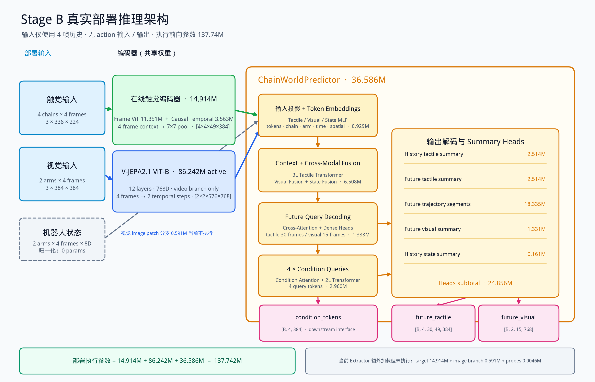

# Tac-JEPA

从当前仓库抽出的可移植 Tac-JEPA 触觉世界模型模块，包含：

- 因果触觉编码器
- Stage A 触觉表征训练
- 未来触觉隐变量预测器
- Stage B 世界模型训练
- 独立部署推理接口
- episode / four-chain 数据加载
- contact 与 chain manifest 构建工具
- 最小 V-JEPA2.1 视觉编码器依赖

不包含原始数据、训练 checkpoint、报告、可视化实验和与触觉世界模型无关的
其他模型代码。模型结构与训练目标未改动。

## 目录

```text
Tac-JEPA/
├── tac_jepa/
│   ├── models/       # tactile encoder, chain encoder, future predictor
│   ├── data/         # manifest-backed datasets
│   ├── training/     # Stage A/B, losses, split, runtime
│   ├── vision/       # minimal frozen V-JEPA2.1 integration
│   └── inference/    # lightweight deployment-only forward path
├── configs/          # portable YAML templates
├── examples/         # inference smoke example
├── tools/            # conversion and manifest builders
├── tests/            # checkpoint-free model contract tests
└── docs/
```

## 安装

```bash
cd Tac-JEPA
python -m pip install -e .
```

也可以不安装，直接设置：

```bash
export PYTHONPATH=/path/to/Tac-JEPA
```

## 推理

```python
from tac_jepa import TactileFutureFeatureExtractor

model = TactileFutureFeatureExtractor(
    "configs/stage_b.example.yaml",
    "checkpoints/stage_a_encoder.pt",
    "checkpoints/stage_b_predictor.pt",
    device="cuda",
)

output = model(
    tactile_chains,  # [B, 4 chains, 4 frames, 3, H, W]
    vision_arms,     # [B, 2 arms, 4 frames, 3, H, W]
    state_arms,      # [B, 2 arms, 4 frames, 8]
)
```

部署路径只构造在线触觉编码器、视觉编码器和 predictor，不构造 EMA target
编码器、contact/slip probes 或数据加载器。

## 数据流程

统一数据处理入口是 `tools/prepare_dataset.py`。它可以直接完成：

```text
原始数据转换
→ contact / slip 检测
→ chains.jsonl
→ episodes_4chain.jsonl
```

Recorder 数据：

```bash
python tools/prepare_dataset.py \
  --format recorder \
  --root /data/upload/recorder_1 \
  --output data/prepared \
  --workers 16
```

如果已经有包含 `contact` / `slip`、`group` 和 `stream` 的 arm-level
manifest：

```bash
python tools/prepare_dataset.py \
  --format manifest \
  --manifest /data/my_dataset/manifest.jsonl \
  --output data/prepared \
  --skip-contacts
```

生成后的训练 manifest：

```text
data/prepared/chains/chains.jsonl
data/prepared/chains/episodes_4chain.jsonl
```

分别填写到 Stage A 和 Stage B 配置的 `manifest` 字段。

`tools/convert_data.py` 仍然单独支持 `umi` 和 `lerobot` 转换，但它们的
原始单链字段不足以直接构造四链 episode。宿主需要先把它们整理为带
`group`、`stream`、`tactile_sides`、`contact` 和 `slip` 的 arm-level
manifest，再使用 `--format manifest`。

也可以单独运行底层处理脚本：

```bash
python tools/convert_data.py ...
python tools/build_contacts.py ...
python tools/build_chains.py ...
```

所有工具均保留原有数据和训练逻辑，只调整了文件组织与导入路径。

## 训练

先修改 `configs/stage_a.example.yaml` 和
`configs/stage_b.example.yaml` 中的：

- `manifest`
- `vjepa_checkpoint`
- 数据路径
- batch size、worker 数和训练步数

### 直接启动 Stage A

```bash
PYTHONPATH=/path/to/Tac-JEPA \
python -m tac_jepa.training.stage_a \
  --config configs/stage_a.example.yaml \
  --output runs/stage_a \
  --device cuda:0
```

CPU 测试时只需改成 `--device cpu`。

Stage A 完成后 checkpoint 位于：

```text
runs/stage_a/best.pt
```

### 直接启动 Stage B

```bash
PYTHONPATH=/path/to/Tac-JEPA \
python -m tac_jepa.training.stage_b \
  --config configs/stage_b.example.yaml \
  --encoder-checkpoint runs/stage_a/best.pt \
  --output runs/stage_b \
  --device cuda:0 \
  --attention per_frame_causal \
  --latent-grid 7x7
```

Stage B 完成后 checkpoint 位于：

```text
runs/stage_b/best_predictor.pt
```

### 一条命令顺序训练 Stage A + Stage B

`tools/train_all.py` 会自动把 Stage A 的 `best.pt` 传给 Stage B：

```bash
PYTHONPATH=/path/to/Tac-JEPA \
python tools/train_all.py \
  --stage-a-config configs/stage_a.example.yaml \
  --stage-b-config configs/stage_b.example.yaml \
  --output-root runs/full_training \
  --device cuda:0 \
  --attention per_frame_causal \
  --latent-grid 7x7
```

输出目录：

```text
runs/full_training/stage_a/
runs/full_training/stage_b/
```

更完整的宿主接入说明见 [docs/INTEGRATION.md](docs/INTEGRATION.md)。

## 最小验证

```bash
pytest -q tests
```

测试不依赖真实数据或 checkpoint，覆盖：

- 触觉编码器 token layout
- 因果前缀不读取未来帧
- future tactile / visual latent 输出 shape
- condition token interface

Stage A、Stage B 和推理的完整小数据闭环结果见
[docs/SMOKE_TEST.md](docs/SMOKE_TEST.md)。

## 依赖边界

- Stage A 只需要触觉数据、触觉编码器与 latent predictor。
- Stage B 额外需要冻结视觉编码器和机器人状态。
- 如果宿主已经有自己的视觉 backbone，可替换
  `tac_jepa.vision.builder.build_visual`，但需保持 predictor 的视觉
  context tensor contract。
- 数据和权重不随模块复制，避免把宿主仓库和大型二进制文件绑定到模块。


