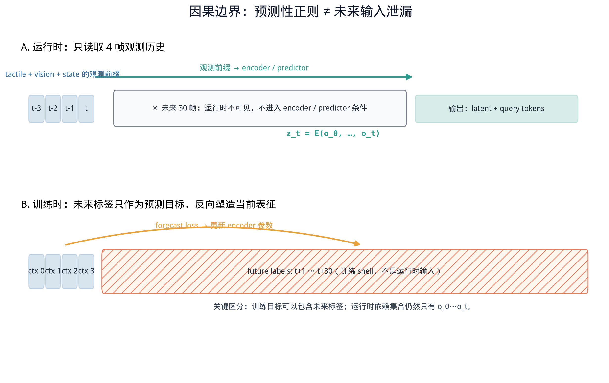
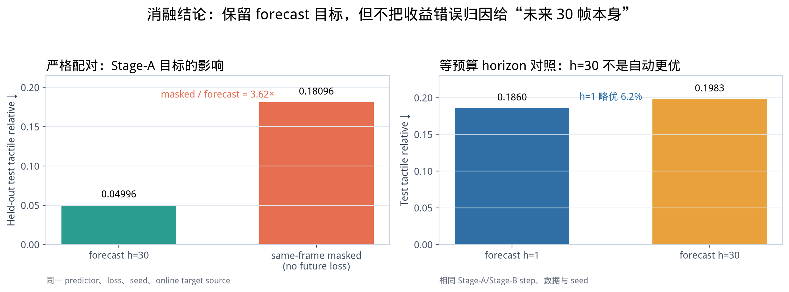
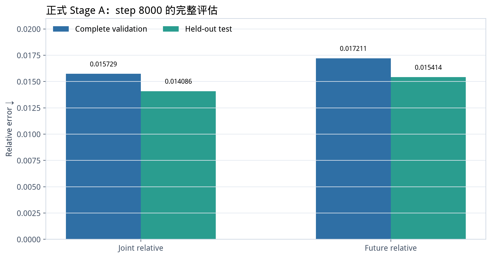
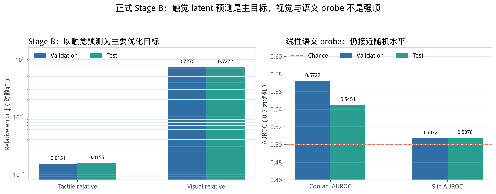
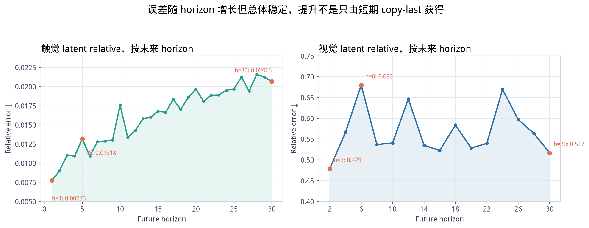
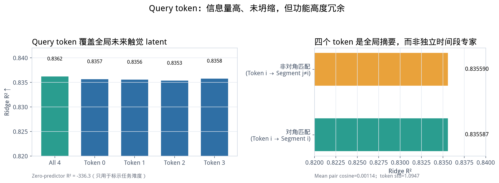
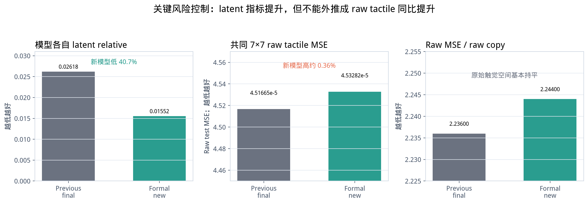

# 触觉世界模型训练复盘：因果编码、未来预测与 Query Token 信息量

> 文档日期：2026-11-15  
> 评估对象：从零正式训练的 Stage A 触觉编码器与 Stage B 未来触觉/视觉 latent 预测器  
> 一句话结论：运行时编码器严格因果；Stage A 的未来预测项只是训练期正则；最终 Stage B 在既定 latent 目标下显著提升，但原始触觉空间只与旧模型基本持平。

## 一、结论先行

1. **运行时不存在未来信息泄漏。** 编码器只读取当前及历史观测，Stage B 也只接收前 4 帧触觉、视觉和状态上下文。运行时关系是 `z_t = E(o_0, …, o_t)`。

2. **训练时使用未来标签，不等于编码结果包含未来。** future forecast loss 通过当前历史特征反传，改变的是“哪些当前征象值得保留”；它不会把未来 observation 放进 encoder 输入。

3. **“必须有 h=30”不是机制真理，但在当前数据和完整训练预算下，forecast 目标仍是更有效的 Stage-A 表征学习方案。** 等预算 horizon 对照中 h=1 略优于 h=30；真正显著的差距来自 forecast vs 无未来标签的 same-frame masking。严格配对下，后者的测试触觉 relative 是前者的 3.62 倍。

4. **最终模型主要服务 Stage B latent 预测和 query-token 使用。** 正式 Stage B held-out test 触觉 relative 为 **0.015516**，四个 query token 对全局未来触觉 latent 的 ridge R² 为 **0.8362**。

5. **不能把 latent relative 的改善同比解释为 raw tactile 改善。** 在统一的 7×7 原始触觉线性读出中，新模型 test MSE 比旧模型高约 **0.36%**。因此若下游主要依赖 latent/query，使用新模型；若强依赖 raw tactile 重建，应继续评估旧 final 模型。

## 二、因果边界：哪些信息可以进入模型



*图 1：运行时只读取 4 帧观测历史；训练 shell 中的未来 30 帧只作为预测标签。预测性正则会反向更新 encoder 参数，但不扩大运行时依赖集合。*

必须区分以下三个概念：

| 情形 | 运行时读取未来 | 训练标签塑造 encoder | 判断 |
|---|---:|---:|---|
| causal encoder + future forecast loss | 否 | 是 | 合法的预测性表征学习 |
| 未来 raw token 作为可见 anchor | 是 | 是 | MAE 式内插，不是纯预测 |
| future target 时间位置错位 | 否 | 是 | 实验实现错误，会污染结论 |

Stage A 的 `per_frame_causal` 路径和 causal prefix invariance 测试均已通过：截断输入前缀不会改变对应时间位置的编码结果。Stage B 中，未来 raw tactile、未来视觉和未来状态都不进入条件路径。

## 三、为什么保留 h=30，但不把它解释成“编码器编码未来”

用户最初的担忧是合理的：未来触觉通常不由历史触觉唯一决定。单靠历史触觉，未来接触、滑移和形变可能是多峰的。因此，未来预测职责应主要交给 Stage B 的 predictor，以及视觉、状态等条件信息。

但“预测未来应由 Stage B 完成”并不意味着 Stage A 不能使用未来标签训练。future forecast 可以迫使当前历史编码保留更有动力学预测价值的征象；它不是把未来输入塞进 encoder。



*图 2：左图是相同 Stage-B predictor、loss、seed 和 online target source 下的严格配对；右图是相同训练预算下仅改变 horizon 的对照。两者共同说明：forecast 目标重要，但“h=30 本身天然优于 h=1”不成立。*

| 实验问题 | 设置 | 测试触觉 relative | 解释 |
|---|---|---:|---|
| 未来标签是否显著影响 Stage-B 输入 | forecast h=30 vs masked p=0.25，无未来 loss | **0.049960 vs 0.180959** | masked/forecast = **3.62×** |
| horizon 数量是否是主因 | 等 Stage-A/Stage-B 预算，forecast h=1 vs h=30 | **0.1860 vs 0.1983** | h=1 略优约 6.2% |
| 修正 Stage-B target 时间轴后的旧对照 | legacy reindex `0..29` vs absolute `4..33` | validation **0.3111 vs 0.2232** | 错位修正后改善 28.3% |

因此，本轮最终方案是：

- 保留 h=30 future forecast 作为 **Stage-A predictive regularizer**；
- 保证 runtime encoder 严格 causal；
- 让 Stage B 独立承担未来 latent 预测；
- 使用 visual/state history 提供未来条件；
- 不把历史触觉描述为“能够唯一决定未来”。

## 四、最终训练配方

### 4.1 Stage A

| 项目 | 最终设置 |
|---|---|
| 训练目标 | future forecast，horizon 30 |
| 时间注意力 | `per_frame_causal` |
| 未来帧处理 | `future_frames` mask；online encoder 不读取未来 raw token |
| latent target | 7×7 |
| 训练 shell | 34 帧，即 4 帧 context + 30 帧未来标签 |
| 运行时输入 | 4 帧历史 |
| 优化 | 8000 steps，batch 16，lr `1e-4`，seed 1 |
| 选中 checkpoint | step 8000 |

“34 帧”仅指训练 shell 的上下文与标签跨度，不表示运行时编码器需要一次输入 34 帧。

### 4.2 Stage B

| 项目 | 最终设置 |
|---|---|
| 条件输入 | 触觉、视觉、状态各 4 帧 |
| 未来 target | 完整 clip 的绝对位置 `4..33` |
| target encoder | EMA |
| predictor | depth 3，hidden 384，6 heads，MLP projection |
| 训练目标 | 30 帧未来触觉 latent + 15 帧未来视觉 latent + 条件辅助损失 |
| checkpoint selection | tactile-only |
| 优化 | 4000 steps，batch 12，lr `5e-5`，seed 1 |
| 选中 checkpoint | step 3750 |
| 动作接口 | **无 action input，无 action head，无 action output** |

完整 Stage-B loss 包含 tactile/visual/condition auxiliary terms，但 best checkpoint 只根据触觉 relative 和轻量 probe 选择，避免辅助项覆盖主要目标。

## 五、正式训练结果

### 5.1 Stage A



| 指标 | Complete validation | Held-out test |
|---|---:|---:|
| Joint relative | 0.015729 | **0.014086** |
| Future relative | 0.017211 | **0.015414** |

Stage A 的 future relative 在验证集和测试集接近，未观察到明显测试集过拟合；context 和 future 两类误差均被稳定优化。

### 5.2 Stage B



*图 4：左图对比触觉与视觉 latent 的 relative；右图显示 contact/slip 线性 probe 仍接近随机水平。不能用本模型替代专门的接触/滑移分类器。*

| 指标 | Complete validation | Held-out test |
|---|---:|---:|
| Tactile relative | **0.015098** | **0.015516** |
| Tactile delta | 0.106336 | 0.109285 |
| Tactile cosine | — | 0.999995 |
| Visual relative | 0.727628 | 0.727151 |
| Contact probe AUROC | 0.572203 | 0.545059 |
| Slip probe AUROC | 0.507218 | 0.507569 |

解读：

- 触觉 latent 预测是本次主目标，validation 与 test 结果接近，正式 checkpoint 选择没有用 test 反向调参。
- visual relative 仍较高，说明本轮没有以视觉预测为主要优化目标。
- contact/slip 线性 probe 接近随机水平；这不能作为“已经学到强语义接触/滑移分类器”的证据。当前模型定位仍是世界模型的未来 latent 表征，而不是事件分类器。

### 5.3 逐 horizon 表现



*图 5：触觉 relative 随 horizon 增长而整体升高，但到第 30 帧仍为 0.02065；视觉 relative 在 0.479–0.680 间波动。*

| Horizon | Tactile relative |
|---:|---:|
| 1 | 0.007734 |
| 2 | 0.008995 |
| 3 | 0.011059 |
| 4 | 0.010915 |
| 5 | 0.013179 |
| 30 | **0.020650** |

视觉 relative 在 horizon 2/6/30 分别为 **0.47878/0.67984/0.51682**。

触觉短期误差明显更低、远期逐渐恶化，但改善覆盖整个 30 帧窗口，并非只来自 copy-last 的短期连续性。

## 六、Query Token：信息量高，但不是四个独立专家



| 评估项 | 结果 |
|---|---:|
| 四个 token → 全局未来触觉 R² | **0.836218** |
| token 0 / 1 / 2 / 3 单独 R² | 0.835653 / 0.835554 / 0.835349 / 0.835777 |
| token 间平均 off-diagonal cosine | 0.001144 |
| token standard deviation | 1.095 |
| token→未来四段的 diagonal R² | 0.835587 |
| token→非对应四段的 off-diagonal R² | 0.835590 |

结论：

1. token 具有较高全局信息量，且没有发生整体坍缩；
2. 单个 token 已接近四个 token 的总覆盖；
3. 对角和非对角 segment R² 几乎相同，说明 token 更像 **4 个全局摘要**，而不是 4 个互不重叠的未来时间段专家；
4. 下游可以拼接全部 token，也可以先使用 1–2 个 token 做轻量 probe，但不应预设 token 与未来片段严格一一对应。

## 七、必须保留的原始触觉空间风险



模型各自 latent 空间中的 relative 会受到 copy baseline 和 latent 几何影响。本轮额外训练了 `predicted future latent → 统一 7×7 raw tactile summary` 的线性读出，并在同一 held-out test 上比较：

| 模型 | 各自 latent relative | 共同 raw test MSE | Raw MSE / copy |
|---|---:|---:|---:|
| 旧 final model | 0.026178 | **4.51665e-5** | **2.2360** |
| 正式新模型 | **0.015516** | 4.53282e-5 | 2.2440 |

这组结果应这样理解：

- 新模型在 Stage-B 定义的训练 latent 空间内显著更好，测试 relative 降低约 **40.7%**；
- 新 latent 的 copy baseline 也从 3.264 变为 7.044，因此不能直接说 raw tactile 误差也下降了 40.7%；
- 在共同 raw 7×7 空间里，两者只差约 **0.36%**，新模型略差，属于真实 trade-off；
- 下游以 latent、query token 为主时选择新模型；下游对 raw tactile 重建非常敏感时，应继续使用或评估旧 final 模型。

## 八、下游运行接口

```text
tactile_chains: [B, 4 chains, 4 frames, 3, H, W]
vision_arms:    [B, 2 arms, 4 frames, 3, H, W]
state_arms:     [B, 2 arms, 4 frames, 8]
```

```text
tactile_context:   [B, 4, 4, 49, 384]
future_tactile:    [B, 4, 30, 49, 384]
future_visual:     [B, 2, 15, 768]
condition_tokens:  [B, 4, 384]
```

Stage B 不返回 action。独立推理封装为 `app/vjepa_2_1/tactile_feature_extractor.py`。

## 九、可复现性与数据划分

| 项目 | 结果 |
|---|---|
| 记录数 | 6212 |
| train / val / test records | 4607 / 948 / 657 |
| train / val / test windows | 9214 / 1896 / 1314 |
| split SHA256 | `e903baca5893c3ee6b9d73de9d31fb1771b1ad832d331e0585f529e48b1cb2ea` |
| 最终 test 复跑 | 触觉 relative 精确复现为 `0.01551625527814247` |
| Stage A SHA256 | `69d79005b0a7d68141371fdfd81ac5c64b93646c6bb001857d0f0d8539ddb2c1` |
| Stage B SHA256 | `128140391fd96a0abc4eee716b7c04e14fb1a32a10f4a517b48ca9a50872e73e` |

最终产物目录：

```text
data/runs/tactile_formal_final_20261115/final_model/
```

目录内包含 Stage A encoder、Stage B predictor、完整 validation/test 指标、逐 horizon 指标、query-token 分析、raw tactile 共同空间比较、模型 manifest 和精确复跑结果。

## 十、最终建议

**以 Stage B latent 预测和 query-token 为下游接口时，使用本次正式模型。**

**若下游任务对原始触觉重建敏感，必须同时评估旧 final 模型，不能仅依据 latent relative 做部署决策。**

**若未来希望改善 raw tactile 物理精度，下一步应把统一 raw readout 或轻量 raw decoder 纳入正式 selection criterion，而不是继续只看 latent relative。**
